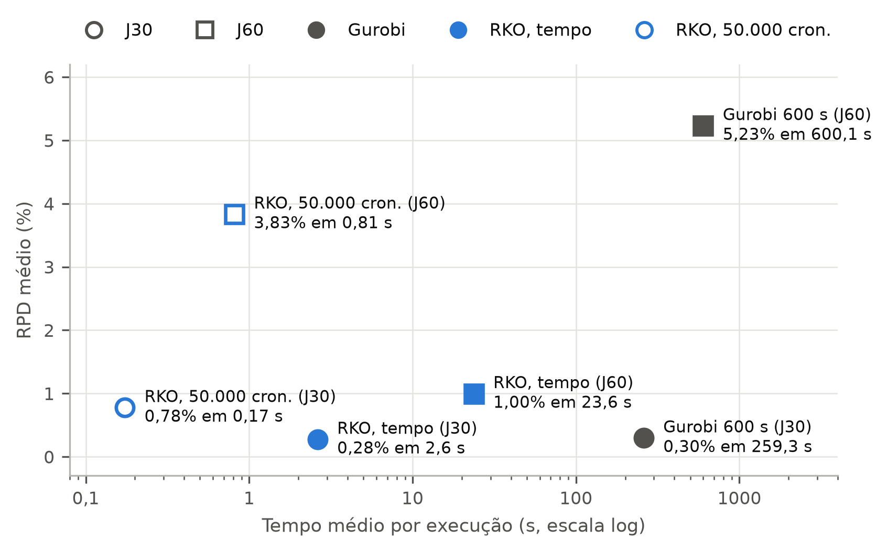
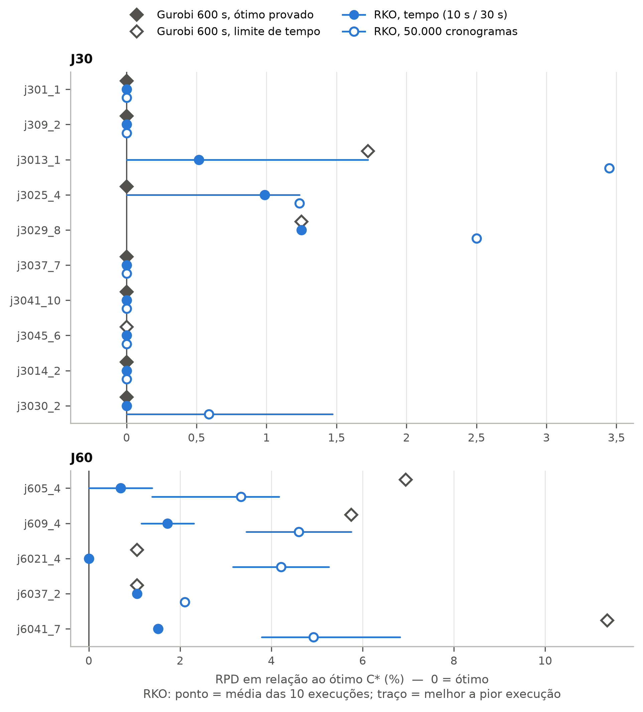
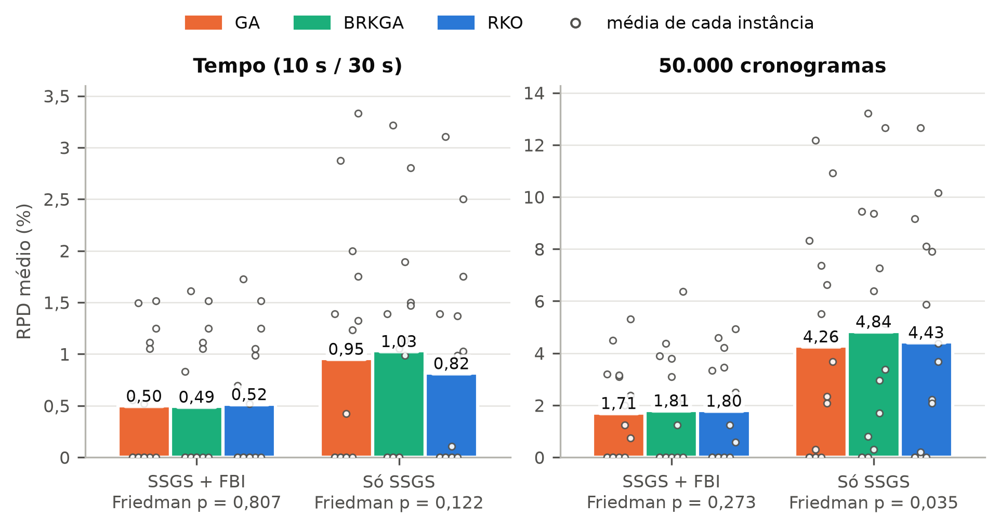
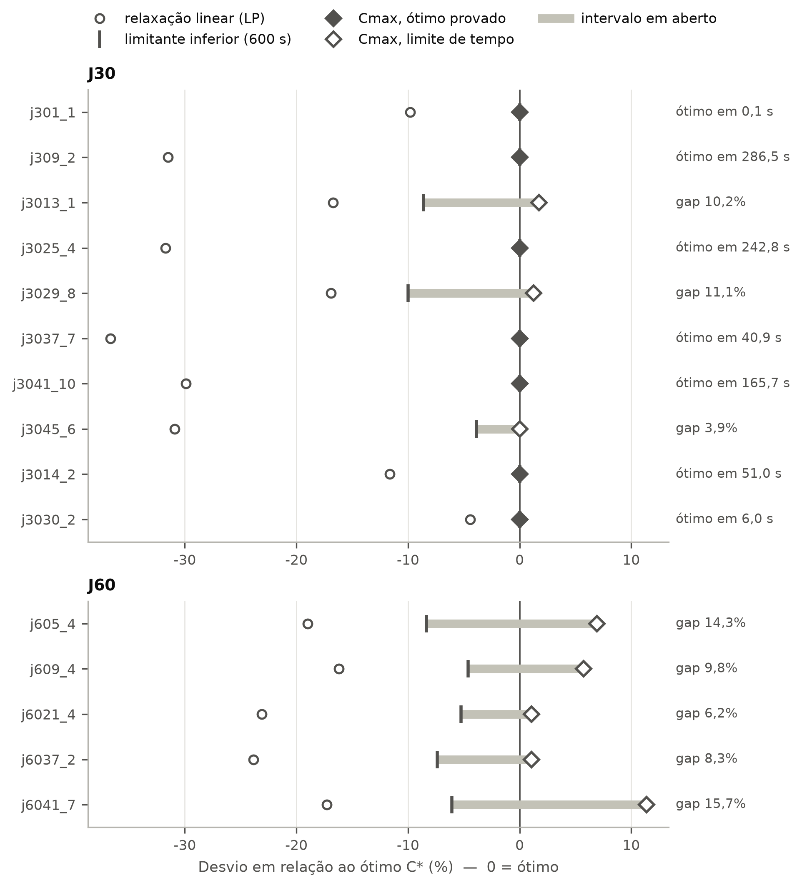

# Sequenciamento da produção de baterias para veículos elétricos via RCPSP

**Método exato (PLIM tempo-indexado + Gurobi) × metaheurística (Random-Key Optimizer) em instâncias PSPLIB J30 e J60.**


Projeto da disciplina de **Otimização Discreta** (UNIFESP). A linha de montagem de baterias de veículos elétricos é modelada como um *Resource-Constrained Project Scheduling Problem* (RCPSP): atividades com precedência e recursos renováveis limitados, e o objetivo de minimizar o *makespan*. O mesmo conjunto de instâncias é resolvido por um modelo exato e por uma metaheurística, e os dois são comparados em qualidade e tempo.

*Battery-production scheduling modeled as an RCPSP: time-indexed MILP (AMPL + Gurobi) versus the Random-Key Optimizer (C++/OpenMP) with a custom SSGS + FBI decoder, benchmarked on PSPLIB J30/J60.*

**Autores:** Cristian Madeira, Otávio Novais, Thaís Melo

---

## Principais resultados

15 instâncias de recurso escasso (10 J30 + 5 J60, todas com ótimo conhecido), 10 execuções por instância no mesmo notebook (Intel i5-1135G7, 16 GB). RPD = desvio percentual em relação ao ótimo.

| Conjunto | Gurobi 600 s | RKO por tempo (10 s / 30 s) | RKO, 50.000 cronogramas |
|---|---|---|---|
| **J30** | RPD 0,30% · 259 s · 7/10 ótimos provados | RPD 0,28% · **2,6 s** | RPD 0,78% · 0,17 s |
| **J60** | RPD 5,23% · 600 s · 0/5 provados | RPD **1,00%** · 23,6 s | RPD 3,83% · 0,81 s |

- **J30:** mesma qualidade nos dois métodos, mas o RKO é ~100× mais rápido. O exato tem a vantagem de **provar** a otimalidade (7 de 10).
- **J60:** o Gurobi não fecha nenhuma instância em 600 s (até 11,4% acima do ótimo). O RKO, com 30 s, fica igual ou melhor em todas as cinco. A formulação tempo-indexada cresce com atividades × horizonte, e a vantagem da metaheurística cresce junto.
- **O decoder pesa mais do que a busca:** GA, BRKGA e RKO são estatisticamente equivalentes com o mesmo decoder + FBI (Friedman p ≥ 0,27). Já o *forward-backward improvement* (FBI) reduz o RPD de 9–10% para 4% no J60 (p < 0,001 nos três métodos).

<p align="center">
  
</p>

<details>
<summary>Mais gráficos</summary>

| | |
|---|---|
|  |  |
| RPD por instância: Gurobi × RKO | GA × BRKGA × RKO, com e sem FBI |



</details>

Relatórios completos: [Etapa 5 — método exato](relatorios/etapa5/etapa5.pdf) · [Etapa 6 — exato × metaheurística](relatorios/etapa6/etapa6.pdf) · [análise estatística](results/analise_metaheuristicas_b50000.md)

## Abordagem

### Método exato — PLIM tempo-indexado

Modelo de Pritsker et al. (1969) em AMPL ([`ampl/rcpsp.mod`](ampl/rcpsp.mod)), executado via `amplpy` com Gurobi. Para torná-lo tratável:

- **Precedência desagregada**, com limitantes inferiores bem mais fortes durante o branch-and-bound que a versão agregada (ex.: 84 × 70 em j3041_10, HiGHS com 60 s).
- **Horizonte** dado pela melhor solução de 7 regras de prioridade + FBI, e **janelas [ES, LS]** pelo CPM: 500–2.300 binárias em vez de ~5.000.
- **MIP start** com o cronograma heurístico, e **verificação independente** de cada solução devolvida pelo solver.

### Metaheurística — RKO com decoder próprio

O [Random-Key Optimizer](https://github.com/RKO-solver/RKO_Cpp_v1.0) (Chaves et al., 2025) roda nove metaheurísticas em paralelo (BRKGA, SA, GRASP, ILS, VNS, PSO, GA, LNS, BRKGA-CS) sobre um vetor de chaves aleatórias. O framework não foi alterado; toda a parte do RCPSP está no decoder ([`rko/Program/Problem/Problem.h`](rko/Program/Problem/Problem.h)):

1. **Chaves → lista de prioridade:** a cada passo, a atividade elegível de menor chave (sempre uma ordem topológica válida).
2. **SSGS:** cada atividade entra no primeiro instante com precedência e recursos satisfeitos (cronograma sempre factível).
3. **FBI:** justificação para trás e para frente, repetida enquanto o makespan melhora (Valls et al., 2005).

### Instâncias

PSPLIB (Kolisch & Sprecher, 1997): todas as 480 J30 e 480 J60 estão no repositório, com ótimos/limitantes de referência obtidos pelo OR-Tools CP-SAT. Os experimentos usam as instâncias com **RS = 0,2** (recurso escasso), as únicas em que os métodos se diferenciam: com RS alto, o ótimo coincide com o limitante trivial.

## Estrutura

```
ampl/          modelo PLIM (rcpsp.mod), runner amplpy (run_exact.py) e .dat gerados
rko/           framework RKO em C++ (MIT); Problem.h é o único arquivo específico do RCPSP
  Instances/RCPSP/   instâncias J30/J60 (.dzn), cenários .csv e alvos de parada
tools/         Python: parser PSPLIB, heurísticas (SSGS, FBI, CPM), referência CP-SAT,
               validação no HiGHS, experimentos, estatística e tabelas
results/       CSVs, logs e análises de cada rodada (mh_<data>/ = metaheurísticas)
graficos/      figuras (PDF + PNG) e o script que as gera
relatorios/    relatórios LaTeX das Etapas 5 e 6
docs/          notas técnicas detalhadas
```

## Como reproduzir

**Requisitos:** `g++` com C++20 e OpenMP; Python 3; licença do Gurobi (ou CPLEX) para o método exato.

```bash
pip install -r requirements.txt

# Metaheurística
cd rko/Program && make rebuild
./runTest ../Instances/RCPSP/test-debug.csv 9 0 1     # teste rápido do RKO (modo debug)
cd ../..

# Método exato
python -m amplpy.modules install gurobi
python -m amplpy.modules activate <licença>
python ampl/run_exact.py --set selecao_j30 --solver gurobi --time 600
python tools/table_exact.py results/exact_selecao_j30_gurobi_D.csv

# Experimento GA × BRKGA × RKO (J30 + J60, 10 execuções)
python3 tools/run_metaheuristics.py                    # parada por tempo
python3 tools/run_metaheuristics.py --budget 50000     # orçamento fixo de cronogramas
python3 tools/run_metaheuristics.py --fbi 0            # decoder só com SSGS

# Figuras
python3 graficos/gera_graficos.py
```

No macOS, o clang da Apple não traz OpenMP: use `brew install gcc` e `make CCC=g++-14`. No Windows, use o WSL.

Argumentos do RKO, opções de compilação do decoder, formato dos cenários e arquivos de saída, validações e cuidados metodológicos estão em **[docs/notas-tecnicas.md](docs/notas-tecnicas.md)**.

## Status

| Etapa | Entrega | Situação |
|---|---|---|
| 1–4 | Problema, revisão, dados, proposta de solução | entregues |
| 5 | Resultados do método exato | [entregue](relatorios/etapa5/etapa5.pdf) |
| 6 | Exato × metaheurística | [entregue](relatorios/etapa6/etapa6.pdf) |
| 7 | Apresentação do artigo (15 min) | em andamento — 02/12 |
| 8 | Artigo no formato SBPO | em andamento — 07/12 |

## Créditos e licenças

- **RKO:** Chaves, A.A.; Resende, M.G.C.; Schuetz, M.J.A.; Brubaker, J.K.; Katzgraber, H.G.; Arruda, E.F.; Silva, R.M.A. *A Random-Key Optimizer for Combinatorial Optimization*. Journal of Heuristics, 31(4), 2025. Código original: <https://github.com/RKO-solver/RKO_Cpp_v1.0> (MIT, ver [`rko/LICENSE`](rko/LICENSE)).
- **Instâncias:** PSPLIB (Kolisch & Sprecher, 1997). Os `.dzn` vêm de [MiniZinc/minizinc-benchmarks](https://github.com/MiniZinc/minizinc-benchmarks) (MIT) e `j301_1.sm` de [PyJobShop/PSPLIB](https://github.com/PyJobShop/PSPLIB) (MIT).
- **FBI:** Valls, V.; Ballestín, F.; Quintanilla, S. *Justification and RCPSP: A technique that pays*. EJOR, 165(2), 2005.
- **Modelo tempo-indexado:** Pritsker, A.A.B.; Watters, L.J.; Wolfe, P.M. *Multiproject scheduling with limited resources: a zero-one programming approach*. Management Science, 16(1), 1969.
